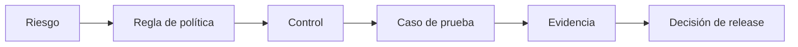

# AI Quality & Governance

**Convertir principios de IA responsable en decisiones, controles y pruebas con evidencia, para productos construidos sobre modelos de lenguaje.**

[English](README.md) · Español

---

## El problema

Que un modelo rechace una solicitud peligrosa no demuestra que el producto sea seguro. El riesgo está en todo el sistema: formularios y prompts, autenticación, APIs, memoria, almacenamiento, logs, proveedores y las personas que lo operan. Y una política escrita en un documento no es lo mismo que un control implementado, probado y aprobado.

Este toolkit cierra esa brecha con una idea: **todo riesgo debe poder seguirse hasta una decisión.**

Ejemplo: `R06 inyección de prompt desde campos guardados → POL-PRECEDENCIA → autorización fuera del modelo + validación de entradas → TC-07 → reporte de ejecución → go / no-go`.

## Qué contiene

| Ruta | Qué es |
|---|---|
| [docs/governance-cycle.md](docs/governance-cycle.md) | Roles y un ciclo de cuatro pasos alineado con NIST AI RMF: Govern, Map, Measure, Manage |
| [docs/risk-catalogue.md](docs/risk-catalogue.md) | Catálogo inicial de riesgos para productos de IA conversacional, con controles y pruebas |
| [templates/risk-register.md](templates/risk-register.md) | Campos del registro de riesgos y escala de severidad (también en [CSV](templates/risk-register.csv)) |
| [docs/llm-test-strategy.md](docs/llm-test-strategy.md) | Estrategia de pruebas para funcionalidades con LLM: atributos, familias de casos, escenarios de alto riesgo |
| [docs/release-gate.md](docs/release-gate.md) | Protocolo de evaluación, criterios de salida y operación después del lanzamiento |
| [docs/regulatory-workstreams.md](docs/regulatory-workstreams.md) | Preguntas legales y de cumplimiento para resolver con asesoría legal, por frente |
| [samples/](samples/) | Muestra de portafolio: framework de estrategia de pruebas para IA generativa (PDF) |

Los documentos detallados están en inglés; este README resume su contenido.

## Marcos de referencia

| Referencia | Cómo la uso |
|---|---|
| [NIST AI RMF 1.0](https://www.nist.gov/itl/ai-risk-management-framework) | Ordenar responsabilidades y el ciclo de riesgo: Govern, Map, Measure, Manage |
| [NIST AI 600-1, perfil de IA generativa](https://www.nist.gov/publications/artificial-intelligence-risk-management-framework-generative-artificial-intelligence) | Ampliar la identificación a riesgos propios de la IA generativa |
| [ISO/IEC 42001](https://www.iso.org/standard/42001) | Mirada de sistema de gestión: política, roles, objetivos y mejora continua |
| [OWASP Top 10 for LLM Applications](https://genai.owasp.org/llm-top-10/) | Superficies de ataque y controles técnicos; registrar la edición usada |
| [EU AI Act](https://digital-strategy.ec.europa.eu/en/policies/regulatory-framework-ai) | Obligaciones según riesgo y deberes de transparencia; sus fechas de aplicación se modificaron, así que hay que revisar el calendario vigente |

Usar estas referencias no certifica un producto ni reemplaza la asesoría legal. Las reglas, prioridades y umbrales de este repositorio son propuestas mías, no exigencias atribuidas a esos marcos.

## Principios

1. **Probar el sistema, no solo el modelo.** Fallan más la autorización, la memoria, los logs y los proveedores que los rechazos.
2. **Desconocido no es bajo.** Un riesgo sin evidencia está *sin evaluar*, y *sin evaluar* nunca cuenta como aprobado.
3. **Un promedio no esconde una fuga.** Un buen puntaje general nunca compensa un fallo crítico.
4. **Las personas revisan lo que las métricas no pueden juzgar.** La evaluación automática clasifica; las personas deciden en los casos críticos y ambiguos.
5. **Cada release se puede reconstruir.** Las versiones de modelo, prompt, política y memoria quedan registradas junto con la evidencia.

## Trabajo relacionado

- [qa-strategy-playbook](https://github.com/ckachury/qa-strategy-playbook): gobierno de releases y métricas de calidad para cualquier producto.
- [test-process-assessment](https://github.com/ckachury/test-process-assessment): método de evaluación de madurez.

## Notas

Este repositorio es genérico: se quitaron nombres de productos, detalles internos e información de clientes. No es asesoría legal. Contenido compartido bajo [CC BY-NC-ND 4.0](LICENSE). Para uso comercial o licencias, [contáctame](https://www.linkedin.com/in/carla-achury-617b7536/).

---

Carla Achury · Calidad y Gobierno de IA · Santiago, Chile · [ckachury.github.io](https://ckachury.github.io)
