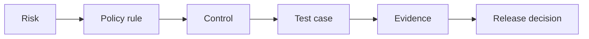

# AI Quality & Governance

**Turning responsible-AI principles into decisions, controls and tests with evidence, for products built on large language models.**

English · [Español](README.es.md)

---

## The problem

A model that refuses a dangerous request does not prove the product is safe. Risk lives in the whole system: forms and prompts, authentication, APIs, memory, storage, logs, vendors and the people operating it. And policies written in a document are not the same as controls that were implemented, tested and approved.

This toolkit closes that gap with one idea: **every risk must be traceable to a decision.**

Example: `R06 prompt injection through stored fields → POL-PRECEDENCE → authorisation outside the model + input validation → TC-07 → execution report → go / no-go`.

## What is inside

| Path | What it is |
|---|---|
| [docs/governance-cycle.md](docs/governance-cycle.md) | Roles and a four-step cycle aligned with NIST AI RMF: Govern, Map, Measure, Manage |
| [docs/risk-catalogue.md](docs/risk-catalogue.md) | Starting catalogue of risks for conversational AI products, with controls and tests |
| [templates/risk-register.md](templates/risk-register.md) | Risk register fields and severity scale (also as [CSV](templates/risk-register.csv)) |
| [docs/llm-test-strategy.md](docs/llm-test-strategy.md) | Test strategy for LLM features: quality attributes, test families, high-risk scenarios |
| [docs/release-gate.md](docs/release-gate.md) | Evaluation protocol, exit criteria and post-launch operation |
| [docs/regulatory-workstreams.md](docs/regulatory-workstreams.md) | Legal and compliance questions to resolve with counsel, by workstream |
| [samples/](samples/) | Portfolio sample: test strategy framework for generative AI features (PDF) |

## Reference frameworks

| Reference | How I use it |
|---|---|
| [NIST AI RMF 1.0](https://www.nist.gov/itl/ai-risk-management-framework) | Organise responsibilities and the risk cycle: Govern, Map, Measure, Manage |
| [NIST AI 600-1, Generative AI Profile](https://www.nist.gov/publications/artificial-intelligence-risk-management-framework-generative-artificial-intelligence) | Widen risk identification to risks specific to generative AI |
| [ISO/IEC 42001](https://www.iso.org/standard/42001) | Management-system view: policy, roles, objectives, continual improvement |
| [OWASP Top 10 for LLM Applications](https://genai.owasp.org/llm-top-10/) | Attack surfaces and technical controls; record the edition used |
| [EU AI Act](https://digital-strategy.ec.europa.eu/en/policies/regulatory-framework-ai) | Risk-based obligations and transparency duties; application dates have been revised, so check the current timeline |

Using these references does not certify a product and does not replace legal advice. Rules, priorities and thresholds in this repository are my proposals, not requirements attributed to those frameworks.

## Principles

1. **Test the system, not only the model.** Authorisation, memory, logs and vendors fail more often than refusals.
2. **Unknown is not low.** A risk without evidence is *not assessed*, and *not assessed* never counts as passed.
3. **An average cannot hide a leak.** A high overall score never compensates for one critical failure.
4. **Humans review what metrics cannot judge.** Automatic evaluation classifies; people decide on critical and ambiguous cases.
5. **Every release is reconstructable.** Model, prompt, policy and memory versions are recorded with the evidence.

## Related work

- [qa-strategy-playbook](https://github.com/ckachury/qa-strategy-playbook): release governance and quality metrics for any product.
- [test-process-assessment](https://github.com/ckachury/test-process-assessment): maturity assessment method.

## Notes

This repository is generic: product names, internal details and client information have been removed. It is not legal advice. Content is shared under [CC BY-NC-ND 4.0](LICENSE).

---

Carla Achury · Quality & AI Governance · Santiago, Chile · [ckachury.github.io](https://ckachury.github.io)
